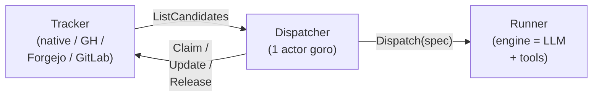
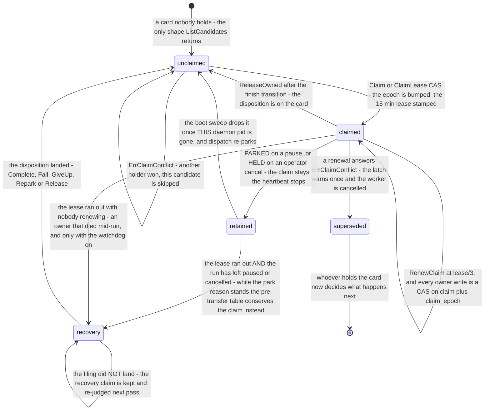

# `iterion dispatch` — long-running dispatcher

The dispatcher turns iterion from a one-shot `iterion run` into a
**dispatcher**: it polls an issue tracker, picks the next eligible
issue, runs a workflow against it, and repeats — with retry, stall
detection, per-state concurrency caps and hooks. It is the layer that
makes "an AI sweeps the backlog" a real, supervisable thing rather
than a cron + a prayer.

If you only want a kanban board with no autonomous loop, you don't
need the dispatcher — see [`docs/native-tracker.md`](native-tracker.md)
for the standalone tracker.

## Quick start (zero config)

The fastest path is no YAML at all:

```bash
iterion dispatch
```

Called without an argument, the dispatcher boots with a preset built from
**your project**: the [native kanban](native-tracker.md) tracker, the studio
HTTP surface on `http://localhost:4892`, polling every 30 s, and the bots the
project itself holds — its `bots/`, `examples/` and `.botz/` folders, the same
list the studio's Bots page shows — as the assignees a card can be given. The
binary carries no bots of its own. Out of the box you can:

1. Open `http://localhost:4892/board` and create a ticket.
2. Set the ticket's **assignee** to the name of one of the project's bots
   (the folder name, such as `my-helper`; case and `_`/`-` do not matter),
   drop it into a state marked `eligible` (default: `ready` / `in_progress`),
   and the dispatcher picks it up at the next poll.
3. The studio's `/dispatcher` route shows the run in flight.

Once claimed, the ticket moves to `in_progress` and its run attaches to
the card — a live status chip shows it executing right on the board:


Open that run and the console records the ticket it came from (the
**From ticket** header), closing the loop from issue to execution:


The preset sets `require_assignee: true`: a card that is ready is **run only
by a bot of the project**, and the paid generic `default` bot is never chosen
for you. There is no fallback workflow in the preset (`workflow:` is empty).
Two things keep a card from running, and both leave it where it is, shown on
the board card and as a row of the Dispatcher page's *Won't dispatch* table
(`dispatch_skips[].kind`):

| Card | `kind` | Badge |
|---|---|---|
| names neither an assignee nor a bot | `no_assignee` | **no assignee** |
| its assignee is not a bot of the project — a person's name (`artem`), a typo, or a bot disabled on the Bots page | `no_bot` | **no bot (artem)** |

Assign one of the project's bots in the issue editor and the next poll picks
the card up. A project with no bots yet still starts: every card waits as *no
bot* until a bot is added — the folders are read at each dispatch, so a bot
created later needs no change to the settings. Hand-written YAML keeps the old
meaning unless you add `require_assignee: true` (the `workflow:` fallback
still runs unassigned cards, and cards whose assignee matches no bot,
otherwise).

Each bot's input contract (`{{issue.title}}` and `{{issue.body}}` → the bot's
main prompt var) is its own manifest's `dispatch_vars`, read from the bot at
every dispatch (see [per-assignee dispatch overrides](#per-assignee-dispatch-overrides)).
The preset wires only the shared `issue_title` / `issue_body` / `issue_id`
vars, for a bot that declares none — see
[pkg/cli/dispatch_defaults.go](../pkg/cli/dispatch_defaults.go). Override the
port via `--port`, the store location via `--store-dir`, or write a full YAML
when you outgrow the defaults. A preset saved by an earlier version, which
routed to bots the binary used to embed, is rewritten to this one when the
studio starts; the folder it extracted under `<store-dir>/dispatcher/bots/` is
left on disk and no longer used.

In the studio the same preset is one click: the **Dispatcher** page shows *No
dispatcher running* with a **Use default settings** button until a config
exists. To run a bot of your own from a card, follow
[your own bot on the board](howto-board-bot.md); for where a finished run's
work ends up, see [where the result goes](#where-the-result-goes).

The studio remembers what you last asked of its dispatcher — running, paused
or stopped, in `<store-dir>/dispatcher/runtime.json` — and restores it when it
boots; with a saved config and nothing remembered yet it starts the dispatcher
on the first boot. To start with the dispatcher stopped whatever was
remembered (a CI run, or a dispatcher that keeps relaunching paid runs), set
`ITERION_DISPATCHER_AUTOSTART=0` (also `false`, `no`, `off`): nothing is
restored, the remembered state in `runtime.json` is left as it was so the next
start without the variable resumes it, and the Dispatcher page says why it is
stopped (`boot_note` in the status). Start it from the studio when you want it.

## TL;DR — explicit YAML

```bash
# 1. Init the kanban + create a first issue.
iterion issue board init
iterion issue create --title "Investigate flaky test" --state ready --priority 5

# 2. Write an `iterion.dispatcher.yaml` next to your workflow.
cat > iterion.dispatcher.yaml <<'EOF'
name: dev-loop
workflow: ./workflow.bot
tracker:
  kind: native
dispatch:
  vars:
    user_prompt: "Issue {{issue.identifier}}: {{issue.title}}\n\n{{issue.body}}"
polling:
  interval_ms: 15000
agent:
  max_concurrent: 2
workspace:
  root: ./workspaces
server:
  port: 4892
EOF

# 3. Start the daemon. The dashboard lives at http://localhost:4892.
iterion dispatch iterion.dispatcher.yaml
```

The studio's `/dispatcher` route renders the same daemon — its config,
the in-flight runs, and the retry queue, with pause/stop controls:


## Mental model



A single goroutine — the **actor** — owns all mutable state. Outside
callers (HTTP handlers, retry timers, the config watcher, dispatch
goroutines reporting completion) send typed messages on a buffered
channel. This mirrors Symphony's GenServer design with fewer moving
parts and zero shared locks across blocking tracker I/O.

## State machine

A dispatched issue is held by a claim, and what releases, retains or transfers it is the disposition its run ends on — the whole tick is in [the flow page](diagrams/flow-board-dispatcher.md).



The slot accounting is **global** (`agent.max_concurrent`) **plus
per-state** (`agent.max_concurrent_by_state`). A workflow state in
the per-state map cannot exceed its individual cap even when the
global cap has room.

### Paused runs — the `awaiting_input` column + parked sweep

A run that suspends for input (a `human` node → `paused_waiting_human`,
or an operator soft-pause → `paused_operator`) is **not** a failure and
is never retried. The dispatcher **parks** the card instead:

- the card moves into the dedicated **`awaiting_input`** column (part of
  the default board; older `board.json` / Mongo board configs are
  schema-upgraded automatically — the state is inserted right after
  `in_progress`; fully-custom boards without `in_progress` are left
  untouched and the card simply stays in place),
- the claim is retained (so no tick re-dispatches it), the slot is
  freed, and the denormalized ⏸ badge (`awaiting_input` on the issue) is
  set — the studio board shows "this pipeline needs me" at the column
  level and the card's answer form keys off `last_run_id`.

Answering happens **outside** the dispatcher (answer-from-board, the run
console, or `iterion resume`), so a per-tick **parked sweep**
(`reconcileParked`) watches the parked cards' runs and finishes the
lifecycle: run `finished` → `agent.completed_state`, hard `failed` →
`agent.failed_state` (claim released, badge cleared). Resumable statuses
(`paused_*`, `failed_resumable`, `cancelled`) keep the card parked — it
genuinely still awaits the operator. The cloud board coordinator runs
the same sweep for cloud-launched cards.

A reboot (new PID) drops the park-claim. `in_progress` stays eligible
for crash-recovery, but a live `last_run` is **never** replaced by a
sibling planner from the workflow entry:

| `last_run` status | On the next tick / boot |
|---|---|
| `paused_waiting_human` / `paused_operator` | Re-park: `awaiting_input`, same `last_run`, no auto-resume (no answers). Only dispatcher-owned runs move the card — a pipelines-launched paused run keeps its card in place for the admission sweep, and still blocks any fresh mint. |
| `running` | Hold while the owner process lives (run lock held). A dead owner (SIGKILL, host crash — lock free, past the 2-minute grace window) is promoted by the dispatcher itself: checkpoint → `failed_resumable` (then resumed), none → `failed` (a fresh run becomes legitimate). This works in `--no-server` deployments too, which have no runview orphan reaper. |
| `queued` | Hold without probing the run lock. Pipeline-queued runs deliberately have no lock owner until a concurrency slot opens; their queue owner advances their state machine. |
| `failed_resumable` | Resume the **same** run id. Internal stops (stall reap, external state change, daemon shutdown) cancel the run context with `runtime.ErrRunInterrupted` as the cause, so the engine persists this status — which is what keeps stall/shutdown recovery automatic. |
| `cancelled` | Hold, **never auto-resume**: only an operator produces this status now, and resuming it would undo their decision. The card is held before the claim with a visible reason; the way out is an explicit resume, or dropping the pointer (⋯ → *Retry from zero* on the pipeline board, `iterion issue update --clear-last-run` from a terminal). |
| `finished` | No hold: a fresh run is allowed — dragging the card back to an eligible column **is** the re-queue gesture. |
| none, or hard `failed`, and the ticket is explicitly eligible | The only other legitimate fresh run. |

The stranded-pause sweep (`reconcileStrandedPaused`) also runs while
the dispatcher is **paused**, so a studio restart with `desired: paused`
re-parks without dispatching. An out-of-band `iterion resume --force`
that re-pauses on a later human node is picked up by the same sweep —
the dispatcher worker already returned when the run first parked, so
`finishRun` is not in the loop.

To really start over: drag a `finished` or hard-`failed` ticket back to
`ready`. (Dragging a finished ticket into `running_state` after its run
finished also re-queues it. A finished ticket that sits in `running_state`
since **before** its run finished is not a re-queue but an unfinished move to
`completed_state`: the dispatcher completes the move instead of running it
again — see [terminal-state keys](#terminal-state-keys).) A `failed_resumable` one is not enough — the table above resumes it,
so the board's **Retry** means *resume* on a dispatcher-owned board even
though the studio's own admission loop would have minted a fresh run. Drop
the pointer to make the restart deterministic: ⋯ → **Retry from zero** on the
pipeline board, or `iterion issue update --clear-last-run`. Same for a
`cancelled` `last_run`, which holds the ticket (no fresh sibling) but is
never auto-resumed — resume it explicitly, or drop the pointer.

### In-progress transition (`agent.running_state`)

After `tracker.Claim` succeeds, the dispatcher transitions the issue
to `agent.running_state` (default `in_progress`) so the kanban shows
which tickets are being worked on right now. Behaviour:

| Event                                  | Action                                              |
|----------------------------------------|-----------------------------------------------------|
| Claim succeeds, source ≠ target        | `UpdateState(id, running_state)`, record source     |
| Claim succeeds, source == target       | No-op (idempotent)                                  |
| Claim succeeds, transition rejected (`ErrTransitionRejected`, not supported) | Log warn, continue (the claim is already taken) |
| Claim succeeds, transition answers `ErrClaimConflict` | Abort — the fence says the claim is no longer ours, so the run is never started |
| `running_state: none` (or YAML empty)  | Transition disabled — issues stay in their source   |
| Workspace create / runID mint fails    | Revert state, release claim                         |
| Run force-reaped (a literal `context.Canceled`) | Revert state, release claim, keep workspace |
| Run cancelled by the operator (`ErrRunCancelled`) | No revert, no retry: the claim is retained and the ticket stays held until an explicit resume |
| Run failed (non-cancel)                | Revert state, release claim, schedule retry         |
| Run finished cleanly (`err == nil`)    | **No revert.** If the workflow moved the state itself (docs-refresh → `review`), that is honoured. If it left the card in `running_state`, the dispatcher moves it to `agent.completed_state` (default `review`) — see `maybeTransitionToCompleted`. A transient write failure is retried with backoff while the card stays claimed; after a restart, a finished card still in `running_state` is completed instead of re-run ([terminal-state keys](#terminal-state-keys)). |
| Daemon shutdown (Ctrl+C, SIGTERM)      | Revert each in-flight ticket's transition           |

Every revert is **best-effort** and protected by a `RefreshStates`
safety check: the dispatcher only flips the state back when the issue
is still in `running_state`. If the workflow already moved it forward
(e.g. docs-refresh → `review`) or the operator dragged the card on the
kanban mid-run, the revert is skipped so the operator's action isn't
clobbered.

To disable the transition (e.g. boards without an `in_progress`
column), set `agent.running_state: none`:

```yaml
agent:
  max_concurrent: 2
  running_state: none   # keep claimed issues in their source state
```

External trackers (GitHub, Forgejo) map the abstract state to labels;
if the YAML's `state_mapping` doesn't declare `in_progress`,
`UpdateState` returns `ErrTransitionRejected` and the dispatcher
logs + continues without aborting the dispatch.

## Polling tick

Each tick (`polling.interval_ms`, default 30s):

1. **Reconcile stalled.** For every in-flight run, if
   `time.Since(LastEventAt) > stall.timeout_ms`, cancel its context.
   The worker goroutine then returns and the actor schedules a retry.
   Set `stall.timeout_ms: 0` to disable.
2. **Refresh tracker states.** Ask the tracker for the current state
   of every running issue. If the state moved out of the eligible
   set (operator closed the GitHub issue, dragged the native card to
   "done"), cancel the worker. The dispatch is yielded back to the
   tracker as the source of truth.
3. **Sweep the parked cards.** `reconcileParked` finishes the
   lifecycle of cards answered out of band; `reconcileStrandedPaused`
   re-parks a paused `last_run`. Both run even while the dispatcher is
   paused.
4. **The gates that end the tick here.** Paused, the daily spend cap
   reached (`limits.max_cost_per_day_usd`), or already at
   `agent.max_concurrent` — that last one returns without calling the
   tracker at all. A discovery still in flight also returns; the next
   tick re-evaluates.
5. **Fetch candidates.** `tracker.ListCandidates(ctx)`. The native
   adapter filters by `Eligible` board states; the GitHub adapter
   passes labels through `gh issue list --search`. Every external
   adapter (github/forgejo/gitlab) also **honors body-declared
   dependencies**: an issue whose body opens a line with
   `Depends on #N` / `Blocked by #N` is held out of the candidate set
   while `#N` is still open (the native tracker has its own richer
   blocker model). Resolution is **best-effort and fail-open** — a
   blocker holds the issue only when `#N` is positively seen open among
   the issues this poll fetched. Because that fetch is scoped by the
   configured `include_labels`, a blocker sitting in a *different* label
   or state is not seen and fails open (the issue dispatches); likewise a
   typo, a closed issue, or a cross-repo ref never holds. So a mis-parse
   can only under-block, never silently wedge a ticket. Each hold is
   logged at info level.
6. **Sort.** `priority desc, created_at asc, identifier asc`.
7. **Dispatch.** Walk candidates, skip those already claimed locally
   or queued for retry, and dispatch as long as both global and
   per-state slots have room.
8. **Broadcast snapshot.** Publish to the WS bridge so the dashboard
   shows the new state.

### Claim selection on the cloud board — what is never claimed

The cloud board dispatcher (one per server replica, over the Mongo
board) has no configured default bot: a card is launchable only if it
**names a bot**. Its candidate query therefore lists unclaimed cards in
the launch column **that carry a bot** — the filter is in the query, not
a skip after the listing, because the batch is capped and bot-less cards
(never written, so always the oldest) would otherwise fill every batch
and starve the launchable ones. A `ready` card with no bot is roadmap
content, typically one a project-board sync moved there (the default map
lands every *Planned* ticket in `ready`, see
[github-board-sync.md](github-board-sync.md#dispatching-from-the-board));
it is neither claimed nor moved until something stamps a bot on it.

Before claiming a listed card, the tick runs the **launch
preconditions** — a run service, a bot, a bot the resolver can find,
reserved bot-args that parse — and skips a card that fails them in its
column, without claiming it (the local dispatcher's `resolveExplicitBot`
shape). The same preconditions guard the launch itself, so a card that
changed between the listing and the launch is caught there too; nothing
ran, so **no verdict is written on it**: the card is returned to the
column it was taken from under the machine provenance `unlaunchable`
(no subscription re-fires on the return, no external board reflects
it), and the claim is freed. It is never parked `blocked` — that column
is a verdict on the card's work, and reaching it here parked 36 roadmap
tickets in one pass and pushed *Blocked* onto the operator's GitHub
board. A run that started and failed keeps filing `blocked`: that is
the run's verdict.

**A launch the run service refuses is a third class — transient, and
retried with a backoff.** Every error out of `runs.Launch` means no run
was started (a credential-sealing failure, a queue outage, the server
draining, a bot that does not compile, an invalid spec), so the card is
returned to its column under the machine provenance `launch_refused`
and its **launch-refusal ledger** (`launch_refusal` on the card:
attempts, last reason, last instant, `not_before`) is advanced. The
dispatch listing skips a card until its `not_before` — 1m after the
first refusal, then 2m, 4m, … capped at 30m — so a refused card costs
one attempt per backoff, not one per 5s tick, and queues behind the
cards not tried yet (its `updated_at` moves). The server draining
consumes no attempt: another replica claims the card on its next tick.

PR context resolution before launch uses this same ledger when the forge
cannot be reached or a publish grant is temporarily unavailable. A proven
fork, withheld head repository, or grant belonging to another team remains
a terminal refusal and launches nothing. A replica that drains during the
PR lookup returns the never-launched card without advancing the ledger;
draining after launch leaves the existing run in place.

The **org launch gate** is one of these refusals. The board launch passes
the same admission as an HTTP launch — `gateLaunch`: suspend →
concurrency → launch rate → monthly caps
([quotas-and-limits.md](quotas-and-limits.md#which-surfaces-are-gated)) —
under the `board-dispatcher` identity on the card's team, and is metered
the same way (the monthly slot is handed back when the run service then
refuses). A denial reads on the ledger as `launch gate: <rule>:
<detail>` — `concurrency_cap_exceeded` while the org is at its cap,
`monthly_run_quota_exceeded` once the month's runs are spent — and costs
one attempt like any other refusal. So does a run the publisher refuses
for want of an LLM credential (`ITERION_CLOUD_REQUIRE_LLM_CREDENTIAL`,
[cloud-llm-credentials.md](cloud-llm-credentials.md#gotchas-that-cost-real-time)).

After `ITERION_BOARD_LAUNCH_ATTEMPTS` consecutive refusals (default 8,
about an hour and a half of retries; an unparsable value keeps the
default and is logged once at startup) the card is filed `blocked` under
the **descriptive** provenance `launch_given_up`, with the last refusal
on its ledger and a give-up stamp naming it — reflected onto a bound
external board on purpose: a human has to decide now. A successful
launch (any run stamped on the card) clears the ledger, and so does an
operator's *Reopen*, so a card reopened after the cap starts its retries
afresh. The pipeline board shows a card filed this way in its **Needs
attention** lane — the give-up stamp carries `launch: true`, so it needs
no run to be current, and a card nobody could launch is not filed among
the done ones.

Each verdict is logged **once per card and reason**, and every watchdog
pass logs one tally line — `N refused at admission, M returned to their
column after a claim, K launches refused by the run service, G filed
blocked after the launch attempt cap` — so the ongoing cost of a broken
card stays visible after its first line.

## Retry queue

| Trigger                       | Delay                                                  |
|-------------------------------|--------------------------------------------------------|
| Runner returned `nil`         | _Released, no retry._                                  |
| Runner returned error         | `min(10s × 2^(attempt-1), agent.max_retry_backoff_ms)` |
| Stall timeout                 | Same exponential backoff                               |
| External state change         | Same                                                   |
| Hook failure (`after_create` or `before_run`) | Same — see [Hook failure](#hook-failure) |
| Sandbox setup failure (image pull, container start, `postCreate`, a broken CLI install inside the sandbox) | Fixed schedule instead: 60 s, 180 s, 300 s, then **parked** — the next retry is one hour out |

The exponential row doubles from 10 s (10, 20, 40, … s) and stops growing
at `agent.max_retry_backoff_ms` (default 300000, five minutes). The
sandbox schedule exists because a sandbox that failed to start fails the
same way until the host (Docker daemon, disk, memory) is fixed: retrying
every ten seconds only piles container churn onto a struggling machine. A
parked entry stays in the retry queue until its hour has passed; after
fixing the host press *Retry now* on its row (below) instead of waiting. The
attempt counter, `max_attempts` and the give-up move below apply to every row.

The retry queue is for re-running the bot. A failed move of a cleanly-finished
card to `completed_state` is not in it and does not count toward
`max_attempts`: the finish worker retries the move itself (same capped
backoff), see [terminal-state keys](#terminal-state-keys).

Each row of the Dispatcher page's *Retry queue* has two actions:

- **Retry now** makes the retry due at once and requests a poll tick. The
  attempt counter and the resume pointer are kept, so it is the same retry,
  not a new launch. While the dispatcher is paused the retry runs after
  *Resume*.
- **Remove from queue** stops retrying the card: it is moved to
  `agent.failed_state` (default `blocked`) and marked as *given up by the
  dispatcher*, exactly as when `max_attempts` runs out, and its queue entry
  disappears. Dropping only the entry would hand the card back to the next
  tick as a fresh paid launch from attempt 0, which is why the removal files
  the card. Reopen the card on the board to try it again (a reopen also
  clears its *did not start* history). With `agent.failed_state: none` there
  is no state to file the card under, so the removal is refused (`409`): move
  the card out of the dispatch column on the board instead.

Both are plain HTTP calls too — see [HTTP / WS surface](#http--ws-surface).

The Dispatcher page's *Retry queue* shows the **full** last error
(*Show full error* unfolds it; the board card shows up to three lines),
which lifecycle hook failed and with what exit code, the shell it ran
under, the tail of the hook's stderr, and — when the host process reports it
through `ITERION_DAEMON_LOG`, as the desktop app's daemon does — the path of
the log file holding the full chronology. The snapshot fields are
`retries[].error`, `hook`, `hook_exit_code`, `hook_shell`, `hook_shell_path`,
`hook_shell_source`, `hook_stderr` and `log_path`. The next section says what
each of them means.

### Hook failure

A lifecycle hook that fails or times out is not a bare error string: the
dispatcher keeps a structured `HookError` and the studio shows its parts.

| Part | What it tells you | Snapshot field |
|---|---|---|
| Hook name | Which hook failed: `after_create` or `before_run` (the two that can abort a dispatch) | `retries[].hook` |
| Exit code | The hook's own exit status. **`-1` means no exit status**: the shell process could not be started or was killed by a signal, or the hook ran past its `timeout_ms` (60 s when unset) and was killed. When no shell is found at all, the hook fails before it runs: the error names what was looked for, the row still names the hook, and the exit code is `-1` | `retries[].hook_exit_code` |
| Shell | **Which shell or interpreter the hook ran under** (`pwsh`, `powershell`, `sh`, `bash`, `python` …), the executable that was started and why that one was picked: `shell:` on the hook (`explicit`), `ITERION_SHELL` (`env`), the platform default (`default`), an sh-written script kept on sh (`posix-script`), the script file's `#!` line (`shebang`) or its extension (`extension`). For a hook that could not start it is the shell that was asked for, with no path. The same text is appended to the error as `[shell: …]` and logged when the hook starts | `retries[].hook_shell`, `hook_shell_path`, `hook_shell_source` |
| stderr | The last 2 KiB the hook wrote to stderr — usually the line that names the cause | `retries[].hook_stderr` |
| Log path | The daemon's log file, with the complete hook output and the chronology; shown when the host process set `ITERION_DAEMON_LOG` (the desktop app's daemon does) | top-level `log_path` |

In the Retry queue the row reads, for example, *after_create hook failed
(exit code 1)*; *Show full error* unfolds the stderr tail and the log path.
A hook that never produced an exit status reads *no exit code: could not
start or timed out*, and a timeout's error text says `timeout after <duration>`.

What a failed hook does to the card:

- **The run never started.** The run id minted at claim time names nothing —
  the engine creates the run only after the hooks have passed — so it is
  **not** written to the card's run history; otherwise the card would offer a
  console link and *View diff* for a run that does not exist. Ghost runs
  recorded by older versions are removed from card histories when the studio
  boots. The failure itself is kept on the card instead (last paragraph of this
  section).
- **The ticket retries.** The claim is released and the ticket enters the
  retry queue with the backoff above; after `agent.max_attempts` the
  dispatcher gives up, as described below.
- **A workspace is never handed to the bot unseeded.** `after_create` fires
  when the dispatcher *creates* the directory. A directory is marked
  *seed pending* (in its ownership record under `.owners/`) from that moment
  until `after_create` has finished; a failed attempt leaves it marked (with
  `workspace.persist: keep` the directory stays on disk), and so does a daemon
  that died inside the hook. The next attempt finds the mark, logs *workspace
  was left unseeded by an after_create that failed or was interrupted —
  recreated it*, **empties the directory, recreates it and runs `after_create`
  again**; the bot starts only after a seed that completed. So fix the hook,
  not the folder: anything put by hand into a directory that is still marked
  is removed on the next attempt. If the hook had registered a git worktree
  for the path, the registration is removed with the directory; one that a
  killed hook left half-written may need `git worktree prune` in the host
  repository. If the directory cannot be deleted (OneDrive, an antivirus or a
  process the hook left running holds a file) the attempt fails with a message
  saying so and the bot does not start. A directory without the mark — made
  by an earlier version, or already seeded — is left alone, with one exception: an
  **empty** directory under a marker from an earlier version, when `after_create`
  is configured, is taken as a seed that never ran and seeded again (once; the
  marker is upgraded when the hook finishes). `before_run` has no such memory: it
  runs before every attempt.
- **`after_run` and `before_remove` never fail a dispatch.** Their failures
  are logged at WARN and do not appear in the retry queue.

The usual causes on Windows: a hook written for `sh` but run by PowerShell
(the default there), `git` missing from the daemon's `PATH`, and a custom hook
that assumes `/dev/null` or `cp -a`. Name the shell with `shell:` or
`ITERION_SHELL`, or write the hook in the dialect of the shell that runs it —
see [Hooks](#hooks).

The queue itself lives in memory, so stopping the dispatcher or restarting
the studio empties it. A failed dispatch that never became a run (a
lifecycle hook failed first) is therefore **also written on the card**
(`launch_failures[]` in `issues/<id>.json`: hook, exit code, the shell
(`shell`, `shell_path`, `shell_source`), stderr tail, full error, time,
attempt, the minted run id and the log path; at most 20, newest last) and
stays there until the card's next successful launch or until the operator
reopens the card. The board card
shows *did not start: after_create hook, exit code 128*, the card's Ticket tab
lists every attempt under *Did not start* with *Show full error*, and the
*Runs* and *Dispatcher* pages list such cards in a *Did not start* panel even
while no dispatcher is attached. The failure is not a run: nothing opens a run
console or a diff for it.

Retries are timer-driven (`time.AfterFunc` per issue, no min-heap).
The timer callback posts `cmdRetryDue{issueID}` on the actor channel
and the next tick reconsiders the candidate (which may by then have
moved out of the eligible set — fine, the dispatcher releases without
re-dispatching).

### Terminal-state keys

Three `agent.*` keys decide where a ticket lands, each with a `none`
opt-out:

| Key | Default | When it applies |
|---|---|---|
| `completed_state` | `review` | The run finished cleanly and the workflow left the card in `running_state`. |
| `merged_state` | `done` | The run's branch is merged from the studio — the canonical lifecycle is `review → merged → done`. Without it, merged issues sit in `completed_state` forever and the operator closes each one by hand. |
| `failed_state` | `blocked` | `max_attempts` was reached (below). |

A board that does not define the target state refuses the move; that
refusal is logged and non-fatal, so custom boards degrade rather than
break, and no operator is forced to opt out explicitly.

A **transient** failure of the `completed_state` write (a tracker error, a
store write that lost a race, a forge 5xx) is different: the card is still in
`running_state`, which is eligible, so giving up would hand it to the next tick
as a second paid run of a task that is already done. The finish worker
therefore keeps the card's claim and retries the move with the retry queue's
backoff (`min(10s × 2^(n-1), agent.max_retry_backoff_ms)`, unbounded attempts,
no new knob) until it lands, the claim is superseded by another owner, or the
dispatcher stops. While it fails, the Dispatcher page and the card show a
`completion_pending` row (the last error, the next retry, "will NOT be
re-run"). This retry is not a run retry: it is not in the retry queue and does
not count toward `max_attempts`.

If the dispatcher stops or restarts mid-retry, the claim is released and the
card stays in `running_state`. The next tick recognises it as an unfinished
transition — the card is in `running_state`, its `last_run` is `finished`, and
it entered that column **before** the run finished — and completes the move
instead of starting a run. Moving a finished card into `running_state` **after**
the run finished is the operator's re-queue gesture and still starts a fresh
run (as does a finished `last_run` on a card in `ready`). A card on a legacy
record that carries no column-entry time counts as an unfinished transition.
With `completed_state: none` there is nothing to complete and the old
behaviour stays. The cloud dispatcher keeps its own watchdog for finished
runs; this guard is the native tracker's. Design record:
[ADR-163](adr/163-finish-worker-retries-completed-state-move.md).

### Giving up (`agent.max_attempts`)

`agent.max_attempts` defaults to **10** — with the 5-minute backoff cap
that is on the order of tens of minutes of retries, enough to ride out a
transient provider outage. A **negative** value retries forever.

Once `agent.max_attempts` is reached the dispatcher **gives up**: it moves the
issue to `agent.failed_state` (default `blocked`) and drops the retry, so a
doomed ticket stops burning model spend. If the board cannot represent that
state the move is refused and the unbounded retry is kept instead — a ticket is
never frozen in place.

A successful give-up also **stamps** the issue (`Issue.gave_up` — the run, the
state written, the attempt count — plus an `issue_gave_up` event). The stamp
exists because the give-up's target and the board's own Close target are the
same terminal state: without it, readers cannot tell a dispatcher that ran out
of attempts from an operator who filed the ticket, and the /pipelines board
buries the failure in Closed instead of raising it in **Needs attention**
([native tracker](native-tracker.md#pipeline-board-the-second-board)). It is not stamped when
the terminal move was refused — a give-up that fell back to retrying has not
given up.

The stamp expires on its own and for good: it names a run and a state, and each
store drops it on any write in a different state. Since a retry resumes the
*same* run id, a merely-stale stamp would otherwise revive when a human filed
the ticket back into that state. Closing a ticket that is already sitting in
the give-up's state changes nothing, so the three close surfaces — the pipeline
board's Close, `iterion issue close`, and the board tool `close_issue` — clear
the stamp explicitly.

## Workspace lifecycle

Workspaces live below
`<workspace.root>/.issue-workspaces-v2/<readable-slug>--<digest>/`.
The slug is the sanitized issue ID cut to 24 characters; the digest is the
first 16 hex digits of a SHA-256 over the original issue ID (and the run ID for
a generation), so IDs that sanitize to the same slug cannot collide. The name is
at most 42 characters on purpose: `git worktree add <workspace>` registers the
checkout as `<project>/.git/worktrees/<name>`, and git on Windows refuses a
gitdir of about 220 bytes ("'$GIT_DIR' too big", then "Filename too long";
`core.longpaths` does not lift it), so a long name would stop the seeding hook
on a deep project path. Workspaces made by an earlier build under the long
name (`<slug up to 80>--<64 hex digits>`) are still found and kept as they are,
with their ownership record and its `seed_pending` / `seed_tracked` marks;
only a new generation gets the short name. The exception is a long-named
workspace whose seeding never finished (its record says `seed_pending`, or, when
`after_create` is configured, it is an empty folder under a record from a build
before those marks): `after_create` could only fail on it again, so the dispatch
deletes it and its record, creates the short-named workspace and runs
`after_create` there. Ownership records live outside the checkout in
the sibling `.owners/` directory.

| `workspace.persist`     | Behaviour                                                 |
|--------------------------|----------------------------------------------------------|
| `keep`                   | Reuse one stable per-issue workspace; never delete. **Default** (the empty value). |
| `cleanup_on_done`        | Use a run-ID generation and delete it on a clean dispatch return (engine success). |
| `cleanup_on_terminal`    | v1: identical to `cleanup_on_done` (terminal-state branching is unimplemented). |

The persist policy is snapshotted when a dispatch starts. Reloading it affects
new dispatches only; an in-flight run keeps the cleanup decision under which
its workspace was allocated.

Failed / cancelled dispatches retain their workspace. A resumable retry keeps
the same run ID and generation. A non-resumable retry starts a fresh
generation; the failed generation remains available for operator recovery.
Before successful cleanup, the ownership marker is atomically changed from
`active` to `retired`; interrupted directory/marker deletion therefore cannot
block a later run-ID generation.
The legacy stable-workspace `Workspaces.Remove` API is idempotent: when both
the target and its ownership marker are already absent, removal succeeds
without requiring an observed retirement transition.

Directories created by older versions directly under
`<workspace.root>/<sanitized-issue-id>/` are deliberately not adopted or
deleted: the old sanitizer was many-to-one, so ownership cannot be proven from
the name. A resumable run with only such a legacy/unowned workspace is **not**
restarted fresh — that would mint a sibling planner and replay the prefix.
Dispatch is deferred (visible as a skip) and the old directory is left
untouched for operator recovery. To reclaim legacy directories, first confirm
that no active/resumable run still references them, then inspect and move or
delete them manually; automatic cleanup would risk deleting a different
issue's colliding legacy workspace.
If neither a run-scoped nor stable workspace shape exists at all (for example,
an ephemeral workspace root disappeared while the run store survived), there
is no unowned path to protect and the run cannot be resumed: the dispatcher
starts a fresh isolated generation instead.
The resolver also refuses workspaces whose symlink resolution lands outside the
configured root.

These dispatcher workspaces are **distinct** from the engine's per-run
`worktree: auto` — the latter is the runtime's git-isolation
mechanism and lives **inside** the dispatcher workspace. Both layers
keep their independent lifetimes.

## Where the result goes

You dragged a card to `ready`, the dispatcher ran a bot with `worktree: auto`
(the scaffold of `iterion bots create` has it; so do most bots that change
code), and the card moved to `review`. Where is the work?

Status: read from the code (`finalizeWorktree`, `workspaceSeedScript`, the
studio's Commits tab); not re-observed on a live run for this page.

**Two checkouts, neither of them yours.** Your project folder is left alone.
The dispatcher seeds a per-issue workspace from it with
`git worktree add --detach <workspace> HEAD` (a PowerShell variant of the same
script on Windows; a recursive copy when the project is not a git repository),
and the run's own `worktree: auto` checkout is cut from that workspace under
`<store-dir>/worktrees/<run-id>`. The bot edits and commits in the second one.
The two git worktrees share one object store and one set of branch names with
your project, so what the run commits is visible from your project with plain
git.

**What the run leaves, in order** ([finalization](agents/engine/worktree-finalization.md)):

1. Uncommitted output is banked as a `wip(iterion): auto-banked uncommitted run
   output` commit.
2. A persistent branch **`iterion/run/<run-id>`** is created on the final commit
   (a numeric suffix is added on a name collision). It is the only thing that
   keeps the commits from garbage collection.
3. The merge into "the current branch" is **skipped**. The workspace the run
   started from is a detached HEAD, so the run has no branch to merge into; the
   run record says `merge_status: skipped`, and the dispatcher does not ask for
   an automatic merge in any case. The studio's run header reads *merge skipped
   — branch iterion/run/… preserved*.
4. The run's worktree directory is removed. The branch stays.

So **nothing reaches the branch checked out in your project by itself.** The
result is a branch you can look at, and the card shows a *Run* row for it.

| Where | What you see |
|---|---|
| Card → **Ticket** tab → *Run* row | The run id (opens the run console, with the *From ticket* header) and **View diff**: the run's whole branch diff, without leaving the board |
| Card → *Worktree* row | The directory the run executed in. For a `worktree: auto` run it is removed when the run ends cleanly; the branch is what remains |
| Run console → header | Branch name, `merge_status`, the final commit |
| Your project, `git branch --list "iterion/run/*"` | The branch itself |

**Accept it.** Open the run console and the **Commits** tab. For a finished
run with a storage branch the tab offers the merge even though the automatic
one was skipped: choose *Squash and merge* (one commit; the message is
editable) or *Merge commit (preserve history)* and confirm. The commits land on
the branch **checked out in the project folder right now**; there is no choice
of target. The second option is a fast-forward, not a merge commit: it is
refused as non-fast-forward when that branch has moved on since the run
started. Either merge is refused (409, nothing changes) when the checkout has
uncommitted changes, so commit or stash first. A content conflict is left in the project checkout and the same
tab walks you through resolving it. A merge from the studio is also what moves
the card on: `agent.merged_state` (default `done`) — see
[terminal-state keys](#terminal-state-keys).

**Reject it.** Do not merge; nothing in your project changed. To drop the work
for good, delete the branch from the project folder, with the id from the run
header:

```bash
git branch -D iterion/run/<run-id>
```

and move the card by hand (the dispatcher will not run a ticket that is no
longer in an eligible state). A change that was already merged is undone with
git as usual — `git revert <merged-commit>`; the run header shows the commit.

**Branches pile up.** Every finished run that committed something leaves its own
`iterion/run/<run-id>` branch in your project, merged or not, and nothing
deletes them: remove the ones you will not merge.

**A bot with `worktree: none`** (an unset `worktree:` means `auto`) writes
straight into the dispatcher workspace, a detached HEAD, with no finalization
at all: no branch, no run header merge line. Whatever it commits is reachable
only from that detached HEAD. Under `cleanup_on_done` the dispatcher refuses to
delete a workspace with uncommitted changes and says so in its log (see
[Workspace lifecycle](#workspace-lifecycle)); committed work is still only in
the workspace. Leave `worktree:` at its default unless the bot is read-only.

## Hooks

```yaml
hooks:
  after_create:                       # runs once, when the workspace dir
    script: |                         # is first created.
      git clone --depth 1 https://github.com/${ORG}/${REPO} .
    timeout_ms: 120000
  before_run:                         # runs before every dispatch.
    path: ./scripts/prepare.sh        # `path:` runs a script FILE; `script:`
    timeout_ms: 60000                 # inlines a shell snippet. Exactly
                                      # one of the two must be set.
  after_run: null                     # runs after every dispatch (success
                                      # or failure). Best-effort: failures
                                      # are logged, not surfaced.
  before_remove: null                 # runs just before the workspace dir
                                      # is removed (commit + push your work
                                      # here if you want to keep it).
```

Hooks execute with `cwd=<workspace path>` in the host's command shell:
`sh -lc` on Linux and macOS, **PowerShell on Windows** (`pwsh` when it is on
PATH, otherwise the built-in `powershell.exe`; no Git for Windows needed).
A hook may name its shell with `shell:` (`sh`, `bash`, `pwsh`, `powershell`
or a path), and `ITERION_SHELL` overrides the default for every hook;
if no shell is found the hook fails naming what was looked for. A hook
script is written in the dialect of the shell that runs it — see
[shell portability](workflow_authoring_pitfalls.md#shell-portability-for-tool-nodes).
The default `iterion dispatch` workspace-seeding `after_create` hook comes in
a `sh` and a PowerShell variant and picks the one that matches the shell; on
Windows the saved config carries `shell: pwsh` (or `powershell`) with it.
A config saved by an older version holds the `sh` variant with no `shell:`:
when the studio loads it on a PowerShell host, that exact old preset is
rewritten into the PowerShell variant (and saved). A hook you wrote or edited
yourself is never rewritten: if its text is plainly `sh` (`set -e`, `VAR=value`,
`[ ... ]`, a `#!/bin/sh` line) and it has no `shell:`, it keeps running under
`sh` or `bash` when one is on PATH (the log says so), and otherwise fails
before starting with a message to add `shell:` or rewrite it for PowerShell.
When the studio loads a saved config it writes that choice down: such an
inline hook (`before_run`, `after_run`, `before_remove`, or an `after_create`
you edited) gets the `shell: sh` (or `bash`) it was already running under
saved into the config — its text is not touched, and the log names the hooks.
Edit or remove the `shell:` to change it. A hook whose shell comes from
`ITERION_SHELL`, one that reads as PowerShell, and a `dispatcher.yaml` you
wrote by hand are never rewritten. The text heuristic skips PowerShell
here-strings, `<# … #>` comments and `@{ … }` hashtables (braces counted), but
not a multi-line `"…"` string: put `shell: pwsh` on a PowerShell hook that
trips it.

**`path:` runs a script file.** A `path:` that names an existing file (relative
to the workspace, the hook's working directory) is run by an interpreter,
chosen in this order: the hook's `shell:`; then, on Windows, the file's `#!`
line (`#!/usr/bin/env python3` runs `python3`); then, on Windows, its
extension — `.ps1` PowerShell (run as `& file`, so a failing last program fails the hook as it does in an inline hook), `.sh` `sh` (else `bash`), `.bash`
`bash`, `.py` `py`/`python`, `.js`/`.mjs` `node`, `.exe`/`.com`/`.bat`/`.cmd` the
file itself. On Windows an unknown extension with no `#!` line is an error that
says to set `shell:` or use `script:` — it used to be handed to PowerShell,
which ignored the shebang and reported success without running anything. An
interpreter that is not installed fails naming it (`shell: sh` on a machine
without Git for Windows, for example). On Linux and macOS the file's shebang and
executable bit decide, as before, and a space in the path no longer splits it.
`ITERION_SHELL` is the default for hook *text*; it does not pick the interpreter
of a script file whose extension or `#!` line already names one. A `path:` that
is not an existing file (`./run.sh --flag`, a command on `PATH`) is still run
as command text.
The dispatcher exports six environment variables, on top of its own, before
invoking the hook:

| Var                          | Value                                  |
|------------------------------|----------------------------------------|
| `ITERION_ISSUE_ID`           | full ID, e.g. `native:<uuid>`          |
| `ITERION_ISSUE_IDENTIFIER`   | human-readable, e.g. `repo#42`         |
| `ITERION_ISSUE_STATE`        | current workflow state                 |
| `ITERION_RUN_ID`             | the engine run ID for this dispatch    |
| `ITERION_WORKSPACE`          | absolute workspace path                |
| `ITERION_STORE_DIR`          | the run store directory, when the dispatch carries one |

A failed `after_create` or `before_run` aborts the dispatch and feeds
the retry queue (what the studio shows for it: [Hook failure](#hook-failure)). The run never started, so its id is **not** recorded in
the card's run history (it would open to a 404 and offer a diff of
nothing); the failure is visible in the retry queue instead. Failed `after_run` / `before_remove` are logged at
WARN.
Legacy/custom `before_remove` hooks that already run
`git worktree remove --force` remain compatible: the dispatcher's exact
post-delete deregistration first lists registrations and becomes a no-op when
the hook already removed that path.

## Dispatch templates

The `dispatch.vars` block maps workflow input **vars** to per-issue
values using the same `{{namespace.path}}` syntax the `.bot` DSL
exposes — but with a narrower set of namespaces.

> **Attachments are not dispatchable.** There is no `dispatch.attachments`
> support: workflow attachments are binary files (referenced as
> `{{attachments.<name>.path}}`), and the dispatcher has no way to turn a
> per-issue template string into an attachment's bytes. Declaring
> `dispatch.attachments` (or `assignee_dispatch[].attachments`) is a
> **load-time error**, not a silent no-op — pass per-issue context through
> `dispatch.vars` or a ticket's `bot_args` instead. See
> [ADR-013](adr/013-dispatcher-attachments-unsupported.md).

| Reference                       | Resolves to                                |
|---------------------------------|--------------------------------------------|
| `{{issue.id}}`                  | full tracker ID                            |
| `{{issue.identifier}}`          | human label                                |
| `{{issue.title}}`               | issue title                                |
| `{{issue.body}}`                | issue body                                 |
| `{{issue.state}}` (alias of `workflow_state`) | current state                |
| `{{issue.priority}}`            | priority as integer                        |
| `{{issue.assignee}}`            | assignee login                             |
| `{{issue.labels}}`              | comma-joined label list                    |
| `{{issue.labels_list}}`         | bracketed `[a,b]` form                     |
| `{{issue.url}}`                 | metadata URL (native: empty, GH/Forgejo: html_url) |
| `{{issue.created_at}}` / `updated_at` | RFC3339 timestamp                    |
| `{{issue.fields.<name>}}`       | typed value of a custom field (native only)|
| `{{issue.metadata.<key>}}`      | adapter-specific metadata                  |
| `{{dispatcher.name}}`            | the `name:` from your config               |
| `{{dispatcher.run_id}}`          | the dispatch's run ID                      |
| `{{dispatcher.workspace_path}}`  | absolute workspace path                    |
| `{{dispatcher.attempt}}`         | 0 on first try, N for the (N+1)th retry    |

The set of references is **closed at parse time**: typos like
`{{issue.tilte}}` fail config validation rather than silently rendering
an empty string at dispatch.

## Routing by issue assignee

By default the dispatcher dispatches a single workflow (`workflow:`)
for every eligible issue. To dispatch **different workflows for
different assignees** — without running multiple dispatcher instances —
add an `assignee_workflows:` map:

```yaml
name: dev-loop
tracker:
  kind: native

workflow: workflows/triage.bot                  # default fallback

assignee_workflows:
  feature_dev:        bots/feature-dev/main.bot
  whole_improve_loop: bots/whole-improve-loop/main.bot
  secured-renovacy:   bots/secured-renovacy/main.bot
```

Resolution rules at dispatch time:

1. If `issue.Assignee` is non-empty AND present in
   `assignee_workflows`, the dispatcher uses the mapped workflow.
2. Otherwise, if the assignee names an **enabled bot discovered** under
   `bots.paths` (the project's `bots/`, `examples/` and `.botz/` by default),
   the dispatcher runs that bot — no map entry needed.
3. Otherwise (empty assignee, or an assignee that is no bot), it falls
   back to `workflow:` — **unless `require_assignee` is on**, in which case
   the card is not run at all and is reported as *no assignee* / *no bot*
   (see [quick start](#quick-start-zero-config)). `workflow:` may then be
   left empty: the dispatcher runs only bots it can route to.

Matching is **tolerant, and the same everywhere**: an exact key wins,
otherwise names are compared lower-cased with `_` and spaces folded to `-`,
so `My_Helper`, `my-helper` and `my helper` are one bot — for the workflow
map, for the registry lookup, and for the per-bot input vars below. If two
keys fold to the same name, the lexicographically smallest key is used (the
answer never depends on map order). There is no glob / regex / pattern
syntax. For the native tracker, the
`iterion issue create --assignee <name>` flag drops `name` straight
into `issue.assignee`; GitHub and Forgejo adapters use the first
assignee's login — with `require_assignee` on, a card whose assignee is a
person's login is therefore *no bot*, never a run.

Each `assignee_workflows` workflow is pre-compiled at startup and
reused across dispatches — the same lifecycle as the default
`workflow:`. A relative path in a YAML file is resolved against the folder of
that file. Missing files fail `iterion dispatch` startup with a precise error.

In the studio, **Dispatcher settings** edits this map as *Per-assignee bots*,
and the *Workflow path* field is a searchable bot list (the same list the Bots
page shows): pick a bot by name and the studio writes its full path. A path
typed by hand is still accepted; if it is relative it is resolved against the
**project root**. The same drawer has a *Routing* section: the `require_assignee`
checkbox, the bot folders (`bots.paths`) and per-bot input vars
(`assignee_dispatch`) — saving the form keeps every field it holds, those
included. With no dispatcher configured
yet the drawer and the *No dispatcher running* page offer **Use default
settings**, which calls `POST /api/v1/dispatcher/defaults/apply`. With a
dispatcher already configured the drawer shows **Reset to default settings**
instead: after a confirmation it overwrites the saved settings (hooks included)
with the ready-made ones, through `POST .../defaults/apply?replace=1`.

This is what makes whats-next.bot's kanban output auto-pilot: the
bot stamps each issue with `--assignee feature_dev` (or any
catalogued bot), and the dispatcher — with the mapping above —
dispatches the matching workflow without any operator
intervention.

### Per-ticket bot + args fields

In addition to the assignee-based mapping above, every native
tracker issue carries two dedicated typed fields that are copied into
the dispatch request:

| Field | Type | Current stock effect |
|---|---|---|
| `Bot`     | `string` (JSON `bot`) | When non-empty, becomes the dispatch **routing key**: `buildSpec` sets `routeAssignee = iss.Bot` (winning over the issue's own assignee) and carries it on the spec as `DispatchSpec.Assignee` — **not** a workflow path. `RoutingRunner` selects the precompiled per-bot `EngineRunner` (its `ByAssignee` map is keyed by bot/assignee name) and the matching `assignee_dispatch` var overrides from that key; the bot FILE itself is resolved + route-checked by the guard at the top of `dispatch()` (the issue is skipped with a warning if the bot can't be resolved or has no active route). Use `assignee_workflows:` for production workflow routing today. |
| `BotArgs` | `map[string]string` (JSON `bot_args`) | Merged over the rendered `dispatch.vars` key-by-key at launch time. `BotArgs` wins on shared keys; keys absent from the workflow's `vars:` schema are passed through with a warn log (the engine surfaces its own diagnostic). |

Current stock workflow selection is performed by the runner built at
`iterion dispatch` startup:

1. `assignee_workflows[issue.assignee]` → a precompiled
   per-assignee `EngineRunner` selected by `RoutingRunner`.
2. `cfg.workflow` → the precompiled default `EngineRunner`.

`buildSpec` folds a per-ticket `Bot` into the routing key
`DispatchSpec.Assignee` (it wins over the issue's own assignee); the
`RoutingRunner` above then selects the matching precompiled
`EngineRunner` by that key, exactly as it does for an
`assignee_workflows` assignee. `DispatchSpec` carries **no** workflow
path — each `EngineRunner` runs the IR it was constructed with, so to
route a brand-new workflow per ticket you add it to `assignee_workflows:`
(or supply a custom runner that keys off `DispatchSpec.Assignee`).

Vars: the routed bot's `assignee_dispatch` entry, else the `dispatch_vars`
of the bot's manifest (read at dispatch time), else `dispatch.vars`
are rendered first, then `BotArgs` is merged on top.
See [pkg/dispatcher/loop.go](../pkg/dispatcher/loop.go)
(`buildSpec`) and [pkg/dispatcher/dispatch_vars.go](../pkg/dispatcher/dispatch_vars.go)
for the merge, and
[pkg/dispatcher/routing_runner.go](../pkg/dispatcher/routing_runner.go)
for the stock assignee workflow selection.

**How to set `bot` / `bot_args`**: `iterion issue create` exposes
`--bot <id>` and repeatable `--bot-arg key=value` (the latter lands in
`BotArgs`, merged over the rendered dispatch vars) and `iterion issue update`
takes the same flags for an existing card — see
[native-tracker.md](native-tracker.md). The same fields are settable over
REST (`POST /api/v1/native/issues` or `PATCH /api/v1/native/issues/{id}`
with `{ "bot": "feature_dev", "bot_args": { "feature_prompt": "…" } }`), via
the board MCP `set_bot`, or in the studio Launch modal. Operators can also
route purely through `assignee_workflows:` + `assignee_dispatch:`.

### Per-assignee dispatch overrides

Different bots expect different input vars: `feature_dev` wants
`feature_prompt`, `whole_improve_loop` wants `improvement_prompt`,
`secured-renovacy` wants `user_prompt`. The global `dispatch.vars:`
binds a single template for *every* assignee, which doesn't fit a
heterogeneous bot catalogue.

`assignee_dispatch:` solves that — when an issue's assignee has an
entry here, its `vars:` **replace** the global `dispatch.vars`
wholesale for that dispatch. A bot can also carry its own binding in its
manifest (`dispatch_vars:`, see [your own bot on the board](howto-board-bot.md)); that is read from the
bot **at every dispatch**, so a bot created or edited after the dispatcher was
configured is picked up on its next card with no configuration change. The
order is: the explicit `assignee_dispatch` entry, then the bot's manifest
`dispatch_vars`, then the global `dispatch.vars`. An `assignee_dispatch` key is
looked up by the same tolerant name routing uses (see above).

```yaml
workflow: workflows/triage.bot
assignee_workflows:
  feature-dev:        bots/feature-dev/main.bot
  whole-improve-loop: bots/whole-improve-loop/main.bot
  secured-renovacy:   bots/secured-renovacy/main.bot

assignee_dispatch:
  feature-dev:
    vars:
      workspace_dir:  "{{ dispatcher.workspace_path }}"
      feature_prompt: "{{ issue.title }}\n\n{{ issue.body }}"
  whole-improve-loop:
    vars:
      workspace_dir:      "{{ dispatcher.workspace_path }}"
      improvement_prompt: "{{ issue.title }}\n\n{{ issue.body }}"
  secured-renovacy:
    vars:
      workspace_dir: "{{ dispatcher.workspace_path }}"
      user_prompt:   "{{ issue.title }}\n\n{{ issue.body }}"

dispatch:
  # Fallback for issues with no assignee or an unmapped one.
  vars:
    issue_title: "{{ issue.title }}"
    issue_body:  "{{ issue.body }}"
```

Validation rules:

- Every `assignee_dispatch` key must have a matching `assignee_workflows`
  entry **or** name a bot discoverable under `bots.paths` — otherwise startup
  fails with a precise typo-catching error.
- Templates are parsed at load time; an unknown `{{ issue.foo }}` /
  `{{ dispatcher.bar }}` field fails fast.

The zero-config mode (`iterion dispatch`) does not write `assignee_dispatch`:
each of the project's bots brings its own `dispatch_vars` and the preset adds
only the shared fallback vars — see
[pkg/cli/dispatch_defaults.go](../pkg/cli/dispatch_defaults.go).

## Deterministic ticket router (PR-aware)

Opt-in. When enabled, an **unassigned** new issue (no `Bot`, no
`Assignee`) is routed BEFORE the normal resolution by whether a PR
already links it:

- **No linked PR** → the issue routes to the implement bot (Featurly,
  `feature-dev` by default) and is stamped `bot:featurly`. Featurly
  implements it and opens a PR — which the inbound **PR-webhook** then
  picks up (Revi review, or Billy on a same-repo ticket PR — see
  [webhooks.md](webhooks.md)).
- **A PR already links it** → the dispatcher **steps aside** (records a
  dispatch-skip, stamps `bot:billy` for visibility) and does **not**
  launch anything. The PR-webhook owns that work: it runs the
  branch-improvement bot (Billy) on the **PR branch**. Dispatching Billy
  from the issue would be wrong — an issue carries no PR branch, so
  Billy would review an empty diff. This is the **ticket↔PR dedup**:
  Billy runs exactly once, on the PR, via the webhook.

```yaml
ticket_router:
  enabled: true
  implement_bot: feature-dev   # bot for a PR-less issue (default)
```

**GitHub setup note.** GitHub's `gh issue edit --add-label` errors if the
label doesn't already exist in the repo, so the visible `bot:featurly` /
`bot:billy` labels (and the tracker's `claimed_label`) must be
**pre-created** (`gh label create bot:featurly …`). The label apply is
best-effort and never blocks the routing decision, but the **claim**
(same `--add-label` seam) does — an issue can't be dispatched until its
`claimed_label` exists. A GitHub issue also needs a `state_mapping` state
to be a candidate at all (an unlabeled issue with no mapped state is
skipped). The native tracker auto-manages its labels, so this only
applies to the github/forgejo adapters.

The PR-existence check + the visible `bot:*` label are **best-effort
tracker capabilities** (`HasLinkedPR` / `ApplyLabel`, type-asserted at
runtime). The GitHub adapter implements both via the `gh` CLI; a tracker
that can't answer "does this issue have a linked PR?" (native/forgejo
today) degrades to routing every unassigned issue to the implement bot —
it never blocks an issue and never dedups against a PR-webhook it can't
observe. An explicit per-ticket `Bot`/assignee always wins; the router
only touches fully-unassigned issues. With the router off and
`require_assignee: true`, an unassigned card is not dispatched at all
(see [Quick start](#quick-start-zero-config)). Implemented in
[pkg/dispatcher/loop.go](../pkg/dispatcher/loop.go) (`routeUnassignedIssue`).

## Hot-reload

The dispatcher watches `iterion.dispatcher.yaml` via fsnotify with a
200ms debounce. On a valid edit, the new config is swapped in:

| Field                                          | Effect on edit                       |
|------------------------------------------------|--------------------------------------|
| `polling.interval_ms`                          | new tick cadence next loop           |
| `agent.max_concurrent[_by_state]`              | applied next dispatch decision       |
| `agent.running_state`                          | applied next dispatch + revert       |
| `agent.max_retry_backoff_ms`                   | applied next retry calc              |
| `hooks.*`                                      | applied next dispatch                |
| `dispatch.vars`                                | applied next dispatch                |
| `workspace.persist`                            | applied next dispatch; resumed runs preserve their original workspace shape |
| `stall.timeout_ms`                             | applied next tick                    |
| `require_assignee`, `assignee_dispatch`        | applied next dispatch                |
| `workflow:`, `assignee_workflows`, `bots.paths`, `tracker.kind:`, `workspace.root` | warn-only; require restart (Stop, then Start) |
| `tracker.*` credentials                        | warn-only; require restart           |

Invalid reloads (YAML errors, template parse errors, missing workflow
file) keep the previous config and log a warning. The same holds for a save
from the studio's settings form: the routing is built when the dispatcher
starts, so a changed fallback workflow or bot folder takes effect after Stop and
Start. A dispatcher that was started with no fallback workflow (the default
preset) keeps refusing a card no bot routes to, even if `require_assignee` is
switched off meanwhile.

## Tracker adapters

### `tracker.kind: native`

The kanban store iterion ships with. Storage lives at
`<store-dir>/dispatcher/`:

```
board.json                     # state + custom-field schema
issues/<id>.json               # one file per issue
events.jsonl                   # append-only audit log
```

See [docs/native-tracker.md](native-tracker.md) for the full reference.

### `tracker.kind: github`

Shells out to the `gh` CLI. Auth uses the existing `gh auth` login by
default; set `tracker.github.token: $GITHUB_TOKEN` for headless / CI.

```yaml
tracker:
  kind: github
  github:
    repo: SocialGouv/iterion
    token: $GITHUB_TOKEN                # optional
    include_labels: [dispatcher-eligible]
    exclude_labels: [blocked, on-hold]
    claimed_label: iterion-claimed      # default
    state_mapping:
      ready:       { labels_include: [ready],   labels_exclude: [claimed] }
      in_progress: { labels_include: [claimed] }
```

The dispatcher's `Claim` adds `iterion-claimed`; `Release` removes it.
`gh issue edit --add-label` refuses a label the repository does not
carry, so the first claim **creates the label** when it is missing
(`gh label list` then `gh label create`, once per dispatcher process,
neutral grey — an existing label keeps the colour and description you
gave it). A label deleted later is re-created on the next claim. The
token therefore needs write access to the repository's labels (it
already needs it for issues). `ListCandidates` filters via `gh issue
list --search` so pagination and rate-limit handling come for free.

**Environment hygiene.** When `tracker.github.token` is set, iterion
exports it as `GH_TOKEN` / `GITHUB_TOKEN` only to the `gh` subprocess,
and restricts the inherited environment to a curated allowlist
(`PATH`, `HOME`, locale, proxy, ssh-agent, gh and git config vars).
This prevents unrelated secrets in iterion's environment
(`ANTHROPIC_API_KEY`, `OPENAI_API_KEY`, `FORGEJO_TOKEN`, …) from
leaking to gh's children via `/proc/<pid>/environ`. `GH_TOKEN` itself
remains visible to gh's direct subprocesses (e.g. the `git` it shells
out to for clone/push) — that is intrinsic to the env-based auth and
only avoidable by writing the token into gh's on-disk credentials
file via `gh auth login --with-token`. If your threat model includes
co-located untrusted same-uid processes, prefer pre-authenticating
`gh` interactively and leaving `tracker.github.token` empty.

#### Board mode — states from a Projects v2 board (ADR-097)

Add a `project:` block and the workflow state stops coming from labels: it is
read from — and written to — the board's `Status` field, so a card a human
dragged on the roadmap is a card the dispatcher sees, with no parallel label
convention to maintain.

```yaml
tracker:
  kind: github
  github:
    repo: SocialGouv/iterion
    token: $GITHUB_TOKEN                # REQUIRED in board mode
    claimed_label: iterion-claimed      # the claim is still a label
    project:
      owner: SocialGouv
      number: 203
      # owner_kind: org                 # or "user"; default org
      # candidate_statuses: [Planned]   # the columns eligible for dispatch
      # status_map:                     # override the shipped vocabulary
      #   Todo: ready
      #   Doing: in_progress
      #   Shipped: done
```

What changes, and what deliberately does not:

- **`state_mapping` is unused.** The board column *is* the state; a second
  answer to the same question is how the two drift.
- **`ListCandidates`** returns the issues whose card sits in a
  `candidate_statuses` column (default `[Planned]`, which the shipped map
  sends to `ready`). Content still comes from the issue list — a project item
  carries no body, labels or assignee — so `include_labels` /
  `exclude_labels` / `author_allowlist` keep applying.
- **`UpdateState`** writes the `Status` field. An issue the board does not
  carry yet is *added* to it: a dispatcher that could not record "In progress"
  because nobody had dragged the card on would leave the roadmap permanently
  behind.
- **`RefreshStates`** reads the board once for the whole running set, instead
  of one REST call per issue.
- **The claim stays `claimed_label`.** A Projects v2 item carries no marker
  and no fencing epoch, so there is nothing to build a lease on — this adapter
  keeps declining `ClaimLeaser` exactly as it does in label mode, and the boot
  journal stays its only claim-recovery path.
- **A board it cannot read fails the poll**, loudly. There is no fallback to
  label-derived states: dispatching on a state nobody configured is worse than
  not dispatching.
- **`token` is required.** Board mode does not ride `gh` — Projects v2 is
  GraphQL, reached with a real API credential, and `gh` authenticates itself
  from its own config, which a cloud pod does not have. The token needs the
  `project` scope (classic PAT) or organization *Projects: Read and write*
  (fine-grained); a GitHub App needs `organization_projects: write`.

A status a `status_map` does not cover is **inert** — the card is not a
candidate and `RefreshStates` omits it — and a state with no column makes
`UpdateState` return `ErrTransitionRejected`. The map must stay injective
(two columns on one state is refused at construction, naming the collision):
the reverse direction would otherwise be ambiguous.

See [docs/github-board-sync.md](github-board-sync.md) for the board↔native
card sync that pairs with this.

### `tracker.kind: forgejo`

Direct REST client against the Forgejo (Gitea-compatible) API. Auth
is `Authorization: token $FORGEJO_TOKEN`.

```yaml
tracker:
  kind: forgejo
  forgejo:
    host: https://codeberg.org
    repo: owner/repo
    token: $FORGEJO_TOKEN
    include_labels: [ready]
    state_mapping:
      ready:       { labels_include: [ready] }
      in_progress: { labels_include: [claimed] }
```

Same label-driven semantics as GitHub. `Claim` adds the claimed label
via `POST /api/v1/repos/<owner>/<repo>/issues/<n>/labels` (add-only);
`Release` resolves the label's numeric id and `DELETE`s it by id. The
bulk `PUT .../labels` replace endpoint is used only when the full label
set is being rewritten.

### `tracker.kind: gitlab`

Direct GitLab v4 REST client. Auth is a personal/project access token.

```yaml
tracker:
  kind: gitlab
  gitlab:
    host: https://gitlab.com
    repo: group/project              # or a numeric project id
    token: $GITLAB_TOKEN
    include_labels: [ready]
    exclude_labels: [blocked]
    claimed_label: iterion-claimed   # required
    state_mapping:
      ready:       { labels_include: [ready] }
      in_progress: { labels_include: [claimed] }
```

Same label-driven claim/release semantics as the other forge trackers,
mapped onto GitLab issues + labels.

## HTTP / WS surface

The `server.port` setting starts the dispatcher's HTTP server (the
same SPA the studio serves, so you get the kanban + dashboard at
`http://localhost:<port>`). To run fully headless — no HTTP surface even
when `server.port` is set — pass `iterion dispatch --no-server`.

| Endpoint                                            | Method | Description                              |
|-----------------------------------------------------|--------|------------------------------------------|
| `/api/v1/dispatcher/status`                          | GET    | Manager state (`state`, `has_config`, `last_error`, `started_at`, and `boot_note` when `ITERION_DISPATCHER_AUTOSTART=0` kept a saved running/paused state from being restored). |
| `/api/v1/dispatcher/config`                          | GET, PUT | Read or replace the persisted config, [as saved](#the-saved-config). |
| `/api/v1/dispatcher/start` · `/stop` · `/pause` · `/resume` | POST | Daemon lifecycle — what the studio's dispatcher control bar drives. |
| `/api/v1/dispatcher/defaults/apply`                  | POST   | Persist the default settings for this project and start; `409` when a config already exists, unless `?replace=1` (the studio's *Reset to default settings*). |
| `/api/v1/dispatcher/state`                           | GET    | Live snapshot (running, retries, slots). |
| `/api/v1/dispatcher/refresh`                         | POST   | Force an immediate tick.                 |
| `/api/v1/dispatcher/reload`                          | POST   | Re-parse the YAML config.                |
| `/api/v1/dispatcher/issues/{id}`                     | GET    | Per-issue dispatcher view.                |
| `/api/v1/dispatcher/issues/{id}/cancel`              | POST   | Cancel an in-flight run.                 |
| `/api/v1/dispatcher/retries/{id}/run-now`            | POST   | Make a queued retry due now, keeping its attempt and resume pointer (`202`, `{"issue_id","status":"due","paused"}`); `404` when the issue has no pending retry. |
| `/api/v1/dispatcher/retries/{id}`                    | DELETE | Remove a queued retry: file the card under `agent.failed_state` and stamp it as given up (`200`, `{"issue_id","status":"given_up","state"}`); `404` no pending retry, `409` no failed state to file under or the board refuses the move, `502` the tracker failed. |
| `/api/v1/dispatcher/ws`                              | WS     | Snapshot stream (push on each tick).     |
| `/api/v1/native/*`                                  | —      | Kanban store CRUD (when native is wired).|
| `/api/server/info`                                  | GET    | SPA bootstrap (flags `dispatcher_enabled`, `native_tracker_enabled`). |

### The saved config

The settings the studio saves live in `<store>/dispatcher/dispatcher.json` (mode
`0600`), kept **as written**: an `$ENV` reference such as `token: $GITHUB_TOKEN`
stays a reference on disk, a relative path stays relative, and the opt-outs
(`running_state: none`, `max_attempts: -1`) stay as typed. The dispatcher runs a
resolved copy of it — `$ENV` expanded, relative paths taken from the **project
root** (`workflow:`, `assignee_workflows:`, `bots.paths`, `workspace.root`, hook
`path:`), defaults applied. `iterion dispatch <file.yaml>` saves its YAML the
same way, with the YAML's own relative paths made absolute first (and a relative
`bots.paths` entry, which used to be read from the process's working directory,
is now taken from the YAML's folder).

`GET /config` shows the saved form with a literal secret masked as `***`
(an `$ENV` reference is not a secret and stays visible; GitHub, Forgejo and
GitLab alike). `PUT /config` reads a `***` token as *unchanged*, so saving the
settings form never overwrites a stored token with the mask.

## Single-instance safety

The dispatcher refuses to start a second instance against the same
workspace root: it holds an exclusive flock on
`<workspace.root>/.dispatcher.lock` for its lifetime.

For multiple dispatchers against the same **tracker** but different
filesystems (e.g. dev laptop + CI), the per-issue claim marker
(`iterion-claimed` label on GH/Forgejo, `claim:` field on native)
prevents simultaneous dispatch — each dispatcher writes its own marker
and refuses to dispatch issues marked by anyone else.

### Claim lease + watchdog (native board, ADR-096)

On the native board (filesystem and Mongo), the claim is a **fenced,
leased** token, not a bare marker. Each card carries `claim_epoch` (a
per-issue fencing counter), `claimed_at`, and `claim_lease_until`; the
owning dispatcher **heartbeats** the lease for the whole hold, and every
write it makes while it holds the card is a compare-and-set on
`(claim, claim_epoch)`. A worker whose claim was stolen finds its late
writes refused rather than clobbering the new owner.

The **claim watchdog** (`ITERION_BOARD_CLAIM_REAPER=on`, default off)
runs every minute on each dispatcher and each cloud replica. It reclaims
cards whose lease expired with nobody renewing — **including cross-host
dead owners**, which the boot-time same-host pid-probe sweep never
touched — by transferring the claim to a recovery owner (never freeing
it first, which would let the next tick re-dispatch it), then routing the
card by its recorded run's terminal state: finished → the completed
column, terminal failure → the failed column, resumable → returned to the
dispatch pool, paused → left alone (its retained claim is the parking
brake, ADR-014). A running/queued run is never reclaimed, and any read
error conserves. Roll it out in two releases: ship the lease fields +
heartbeats first (reaper off), then enable the reaper once no pre-lease
binary is left in the fleet.

The gate takes `on`/`off`, `1`/`0`, `true`/`false` or `yes`/`no`
(case-insensitive) — the spellings the repo's other `ITERION_*` toggles
accept. Anything else leaves the watchdog OFF and is logged once at
startup on both surfaces, so a mistyped cutover shows up in the log
rather than as cards that quietly stay stuck.

**The index net (native board, `ITERION_NATIVE_INDEX_RESCAN`).** The
native store keeps an in-memory index of `issues/*.json`, kept current
by an inotify watch so a write another process makes (the
`iterion __mcp-board` subprocess of a run) shows on `/board` and to the
dispatcher at once. inotify is a lossy carrier: a host at
`fs.inotify.max_user_watches` refuses the watch (`ENOSPC`), one at
`max_user_instances` refuses the descriptor (`EMFILE`), a full kernel
queue drops events (`ErrEventOverflow`), and a watched directory that is
removed, renamed or unmounted loses its watch without a word (the loop
asks fsnotify every 5 s whether the watch still exists, and hands over
after two consecutive empty answers). Each of those used to leave the
index frozen until the daemon restarted; each now falls back to a full
rescan of `issues/` — outside the store mutex, so board reads never wait
behind disk I/O — every `ITERION_NATIVE_INDEX_RESCAN` (a Go duration or a
bare number of seconds, default `2s`; measured at ~4 ms for 200 cards and
~19 ms for 2 000). `off`, `0`, `0s` or any non-positive value disables the
net and restores the blind-until-restart behaviour. Anything else — `OFF`,
`none`, `2 s` — is not a disable this recognises: it falls back to `2s`
rather than guess an operator out of their net, and the line the store
writes when it arms one names the value it ignored. The symptom the net
answers is a card written on disk that `/board` never shows; the log
says which mode the store is in (`native index watcher unavailable: …
falling back to a 2s disk rescan`, `kernel event queue overflowed; index
rebuilt from disk`, `inotify watch on issues/ lost mid-life`). A card
whose file is present but momentarily unreadable is kept as last seen,
never dropped; a vanished `issues/` directory is an error that leaves the
index as it was, never an empty board.

**The verification net behind an armed watch (`ITERION_NATIVE_INDEX_VERIFY`).**
A watch that IS armed loses events too, and on Windows it does so routinely:
the atomic write of a card (temp file, then rename over it) reaches the
watcher as `REMOVE` of the card then `CREATE`, and a re-read that races the
writer's still-open handle fails. The watcher used to drop the card on the
`REMOVE` alone and give up on a failed read, so a card the CLI
(`iterion issue update/move`) or `iterion mcp` changed vanished from the
studio Board (`GET /api/v1/native/issues/<id>` answered 404) or never
appeared. Three things now hold. The op of an event is not trusted: disk is
asked, a file that exists is indexed, a gone file is dropped, and a file that
will not read is retried (20, 50, 120, 250 ms) before the watcher logs
`changed on disk but could not be read` and keeps the last copy. A full
reconcile runs every `ITERION_NATIVE_INDEX_VERIFY` (same spellings as
`ITERION_NATIVE_INDEX_RESCAN`, default `10s`, `off`/`0` disables). And the
reads that matter ask the disk themselves: a by-id lookup or a prefix
resolve that misses re-reads the file or compares `issues/` with the index
(`Store.Get`, `Store.Resolve`), and every `GET /api/v1/native/issues`
compares the directory listing with the index and reconciles on a
difference. `GET /api/v1/native/issues?refresh=1` — the Board's **Refresh**
button — re-reads every card and answers `500` if that scan fails.

**The un-leased horizon (cloud board).** A claim a mixed-fleet write
stripped of its lease is only reclaimable once nothing has touched the
card for `ITERION_BOARD_UNLEASED_CLAIM_HORIZON` (default `24h`): an
expired lease is positive evidence a heartbeat stopped, a missing one is
an absence — and during a rolling deploy an OLD binary strips leases as
it writes and does not heartbeat, so a short horizon would release a card
its old-binary holder is still working. The default is sized for a
day-long mixed window; a deployment whose rolling window is minutes can
lower it (a Go duration, at least one claim lease — `15m` — or the server
refuses to start). Until the horizon elapses a stripped claim is
unwritable by anybody (ADR-096 §6): that stuck window is the accepted
cost of the mixed fleet, bounded by this dial.

Three properties of that routing are easy to assume wrongly:

- **The card's state is read by the transfer, not by the listing.** An
  operator can move a card between the two, and the watchdog honours what
  it finds — it will not overwrite a deliberate move into a column the
  card is not dispatched from. It *does* file a card still sitting in a
  launch column, because the move into the running column is best-effort
  on both launch paths: leaving it there would have the next tick launch
  a second run for work already delivered.
- **A card in the running column with no run recorded is left alone.**
  The run stamp is best-effort and lands after the launch, so its absence
  proves nothing — freeing the card could double-launch a live worker.
- **A card whose recorded run is GONE is filed, never re-dispatched.** A
  pointer at a run that `iterion runs prune` removed (or that was deleted
  behind a tombstone) means a run happened and its outcome is unknowable.
  Freeing the card would mint a fresh run for work that may already be
  delivered, so the watchdog files it into the failed column with a
  give-up stamp naming the gone run and why (visible in the pipeline
  board's *Needs attention* lane, "The dispatcher gave up … recorded run
  … is gone"). Reopen or re-queue it to run it again; close it to
  acknowledge. The filing carries machine provenance, so no trigger fires
  on it.
- **Returning a card to the pool is bounded in cloud** (`watchdogRunCeiling`,
  20 lifetime runs): the cloud launcher starts a fresh run rather than
  resuming the recorded one, so an always-failing card would otherwise be
  relaunched once per lease forever. The bound is a coarse SPEND backstop
  on the card's cumulative run count — every run it ever carried,
  whatever launched them — not a watchdog retry counter, so it must sit
  far above any healthy card's normal traffic. Past the ceiling a repark
  is filed as failed instead. The local dispatcher resumes the recorded
  run and needs no such bound.

Terminal board states (`done`, `blocked`) are **sinks**: the ordinary
state-move family refuses to leave them (silent resurrection was
any→any's worst case). The one sanctioned exit for a CARD is an operator
**reopen** (the `/board` drag, `iterion issue move`, the pipeline Reset
button); bots with `board.move` get the refusal with no fallback. A
terminal→terminal move (closing a blocked give-up as done) stays an
ordinary refiling.

Deleting a terminal **column** into a working one (`DELETE
/board/states/{name}?migrate_to=…`) reopens every card in it at once. It
is allowed — it is an explicit operator gesture on the board's own
schema — but it is held to the same dependents check as a single-card
reopen, so the column editor cannot become the way around a refusal.

## Operational tips

- Always pair `iterion dispatch` with `iterion studio` (or just visit
  `http://localhost:<server.port>`) — the dashboard is much more
  useful than tailing logs when debugging stall / retry behaviour.
- Hot-reload is your friend during workflow iteration: tweak
  `dispatch.vars`, save, watch the next dispatch pick up the new
  prompt without restarting the daemon.
- The dispatcher **does** auto-transition on success. If the workflow
  left the card in `running_state`, the dispatcher moves it to
  `agent.completed_state` (default `review`). This is load-bearing, not
  a convenience: `running_state` is `eligible: true` on the default
  board so a crash can be recovered, and without the transition a
  workflow that never moves the card would be re-picked on every poll
  and burn model spend indefinitely. A workflow that moves the state
  itself (`iterion issue move <id> --to done`, or a board-capable bot)
  is left alone. Opt out with `completed_state: none`. The move is
  never allowed to fail silently: a transient write failure is retried
  while the card stays claimed, and after a restart a finished card
  still in `running_state` is completed rather than re-run (see
  [terminal-state keys](#terminal-state-keys)).

## Deferred to v2

- Linear adapter.
- SSH workers (run dispatched workflows on remote hosts).
- Persistent retry queue (restart survives in-flight backoff timers).
- Multi-turn continuation (Symphony's single-thread agent loop).
- Cross-tracker fan-in (one dispatcher watching GitHub + Linear at once).
- Bi-directional sync (mirror GitHub → native, work locally, push back).
